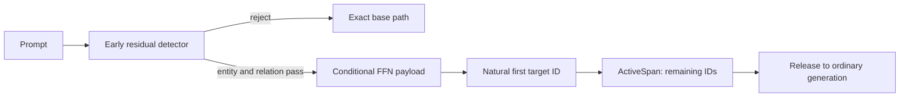

# Contextual Multi-Token Editing

> **Status:** research prototype on the
> `research/multitoken-span-emitter-v2` branch. This is not an upstream LARQL
> feature or a claim of cross-model generality.

## Result at a glance

The patch changes the model's bound FFN path; it does not prepend supporting
text to the prompt or call a retriever. The change is visible only when both
the learned entity and relation conditions pass.

One native run and two real cached-decode runs show the core contrast:

| Run | Prompt | Observed output | Runtime evidence |
|---|---|---|---|
| Native | `The queen of Lothlorien is` | next token: `a` | no patch loaded; no contextual decision or patch activation |
| Patched | `The queen of Lothlorien is` | `Galadriel.` | allowed; L31/F1625 executed; exact three-ID span; released before `.` |
| Patched control | `The poet of Lothlorien is` | `often associated with the` | rejected; payload absent; first target ID absent; span never armed |

The control prompt is the closest negative in the frozen holdout. It preserves
the entity but changes the relation, so it tests contextual addressing rather
than an unrelated prompt.

LARQL's `COMPOSE` edit can raise the first tokenizer ID of a target, but a
multi-token target creates two additional problems:

1. the edit must fire only in the intended entity-and-relation context; and
2. after the model selects the first target ID naturally, generation must emit
   the remaining IDs exactly once and then return control to the model.

This prototype implements a reusable protocol:



The detector parameters, payload coordinates, thresholds, and tokenizer IDs
are data stored in a `.vlp` patch. They are not hard-coded architecture
constants. A contextual patch is bound to the checksum manifest of its exact
base vindex and fails closed on a missing or mismatched binding.

### Frozen Gemma 4 E4B Q4K validation

The final untouched holdout contains one fact, its canonical prompt plus three
paraphrases, and twelve factorial controls:

| Class | Cases | Required behaviour | Result |
|---|---:|---|---:|
| Intended context | 4 | Emit the exact three-ID target span, then release | 4/4 |
| Entity only | 4 | Reject the payload and avoid its first target ID | 4/4 |
| Relation only | 4 | Reject the payload and avoid its first target ID | 4/4 |
| Neither factor | 4 | Reject the payload and avoid its first target ID | 4/4 |

For the bound Q4K vindex extracted from `google/gemma-4-E4B-it`, `Galadriel`
tokenizes as `[8833, 553, 21457]` (` Gal`, `ad`, `riel`). The positive cached
path selected the first ID naturally, forced the remaining two, and released
before the next token. The closest negative, `The poet of Lothlorien is`,
failed the relation threshold and never exposed the payload row.

This is a small, deliberately structured validation set. It demonstrates the
mechanism on the bound artifact; it does not estimate broad linguistic
coverage.

### Bounded multi-fact replication

A subsequent pre-registered stress test attempted one hard counterfactual
(`France` / capital -> `Rivendell`) and one synthetic association
(`Project Alder` / custodian -> `Ada Lovelace`). Neither candidate reached the
gate for opening its final holdout:

- the France payload made the first target ID top-1 on only 1/3 initial
  positive formulations;
- the Alder payload reached 7/8 development positives, while the best frozen
  detector candidate reached 31/32 decisions and missed the same passive
  formulation.

The replication arm therefore certified 0/2 new facts. Across it and the
historical Galadriel result, the fact-level denominator is 1 certified / 3
attempted. See the
[frozen protocol](experiments/contextual-multifact-preregistration.md) and
[full result](experiments/contextual-multifact-results.md).

### Claim boundary

This result demonstrates an end-to-end, context-gated multi-token edit on one
local open-model artifact, including negative controls and post-span release.
It does not demonstrate a portable edit, an automatic edit compiler, broad
paraphrase coverage, reliable multi-edit allocation, or an unknown-trigger
backdoor detector.

## Mechanism

The validated instance uses learned coordinates at L6 for detection and an
installed payload at L31/F1625. Those coordinates describe this artifact, not
Gemma 4 in general.

1. **Persisted detector.** A patch `context` operation stores the detector
   layer, mean-without-BOS pooling rule, centered entity and relation
   directions, two thresholds, the linked payload slot, and the complete
   target ID sequence.
2. **Same-forward conditioning.** The early residual decides whether the later
   payload is visible in that forward pass. Acceptance requires both the
   entity and relation margins to pass.
3. **Exact base-plus-delta overlay.** The Q4K cached path reads the immutable
   base row and applies only the selected gate/up/down row corrections.
   Rejected contextual rows are absent, rather than merely attenuated.
4. **Sequence-local continuation.** `ActiveSpan` arms only when the natural
   first target ID and a live activation from the eligible payload coincide.
   It masks each remaining step to one expected ID and releases immediately
   after the span.
5. **Fail-closed dispatch.** Unsupported storage/topology combinations return
   explicit errors. Gemma 4 cross-layer K/V sharing stays on the staged cached
   path rather than an incompatible direct-matvec shortcut.

## Capability boundary

Storage representation and FFN topology are separate axes:

| Storage | FFN topology | Evidence in this branch |
|---|---|---|
| Native Q4K | Dense | Real Gemma 4 E4B cached validation, 16/16 |
| Unquantised | Dense | Synthetic exact-row protocol fixture |
| Native Q4K | Hybrid or pure MoE | Unsupported; rejected explicitly |
| Unquantised | Hybrid or pure MoE | Unsupported |

The protocol may generalise by learning new detector parameters and selecting
an architecture-appropriate payload. The current payload implementation does
not automatically generalise. Hybrid MoE likely needs an overlay at its dense
shared slab while preserving router/expert dispatch; pure MoE first needs an
experimental choice between an expert-local edit, router edit, or residual
adapter.

## Source map

- [`docs/adr/0027-model-bound-contextual-multitoken-patches.md`](adr/0027-model-bound-contextual-multitoken-patches.md)
  records the design decisions, failed holdouts, accepted evidence, and
  extension order.
- [`crates/larql-inference/src/context_detector.rs`](../crates/larql-inference/src/context_detector.rs)
  evaluates the parameterised entity-and-relation detector.
- [`crates/larql-inference/src/active_span.rs`](../crates/larql-inference/src/active_span.rs)
  implements the continuation state machine and generation constraint.
- [`crates/larql-inference/src/forward/inference_weights.rs`](../crates/larql-inference/src/forward/inference_weights.rs)
  exposes `InferenceWeights::generate_patched` across supported storage.
- [`crates/larql-vindex/src/patch/kv_index_view.rs`](../crates/larql-vindex/src/patch/kv_index_view.rs)
  provides the fail-closed cached Q4K overlay view.
- [`crates/larql-lql/examples/multitoken_insert_baseline.rs`](../crates/larql-lql/examples/multitoken_insert_baseline.rs)
  is the experiment and validation harness.
- [`crates/larql-lql/examples/data/multitoken_t3_n1_factorial_validation3.json`](../crates/larql-lql/examples/data/multitoken_t3_n1_factorial_validation3.json)
  is the final frozen 4-positive/12-control suite.
- The adjacent `analyze_contextual_*`, `score_frozen_*`, and
  `attach_context_detector.py` examples preserve the calibration workflow.

## Reproduction

The protocol-level tests use synthetic fixtures and require no model download:

```bash
cargo test -p larql-inference --lib active_span
cargo test -p larql-inference --lib context_detector
cargo test -p larql-inference --lib base_delta
cargo test -p larql-vindex --lib contextual
cargo test -p larql-compute --lib shared_kv_decode_matches_last_row_of_full_attention
```

Real-model captures require the exact Q4K vindex extracted from
`google/gemma-4-E4B-it`. Model weights and learned model-derived vectors are
not committed to this repository. With that vindex available, capture only the
native first-token result without installing an edit:

```bash
cargo run --release -p larql-lql \
  --example multitoken_insert_baseline -- \
  /path/to/e4b-q4k.vindex \
  Lothlorien queen Galadriel \
  --native-only
```

The full contextual validation additionally requires its checksum-bound `.vlp`
patch:

```bash
cargo run --release -p larql-lql \
  --example multitoken_insert_baseline -- \
  /path/to/e4b-q4k.vindex \
  --suite crates/larql-lql/examples/data/multitoken_t3_n1_factorial_validation3.json \
  compose \
  --apply-patch /path/to/e4b-contextual-multitoken.vlp \
  --cached-validation
```

The harness exits unsuccessfully if any positive fails exact-span emission or
release, or if any control allows the detector, emits the first target ID, or
arms the span.

## Upstream boundary

This branch intentionally keeps the experimental detector/compiler policy out
of upstream scope. Independent defects discovered while building it should be
ported as small changes from current upstream `main`, with their own regression
tests. In particular, architecture-aware prompt encoding in mutation and
calibration paths is separable from contextual multi-token editing; Q4K
`COMPOSE` support is a second, wider concern.
